# PURPLE TEAM DETECTION ENGINEERING LAB: ĐO LƯỜNG & ĐÁNH GIÁ DETECTION COVERAGE TRÊN WAZUH SIEM BẰNG MITRE ATT&CK

<div align="center">


</div>

---

> **ĐỒ ÁN CHUYÊN NGÀNH AN NINH MẠNG**  
> **Đề tài:** Mô phỏng tấn công và đo lường khả năng phát hiện - Đánh giá Detection Coverage của hệ thống phòng thủ SIEM bằng Framework MITRE ATT&CK  
> *(Nghiên cứu, triển khai hệ thống giám sát và phát hiện xâm nhập tập trung sử dụng Wazuh kết hợp Sysmon và Auditd theo mô hình Purple Team)*  
>
> **Sinh viên thực hiện:** Nguyễn Minh Trí  
> **Mã số sinh viên:** `92510340016`  
> **Lớp:** `35CCAN01`  
> **Giảng viên hướng dẫn:** ThS. Trương Phạm Hoài Thương  
> **Cơ sở đào tạo:** Trường Cao đẳng An ninh mạng iSpace (Tháng 09/2026)  

---

## 📌 MỤC LỤC
1. [Giới thiệu đề tài & Bối cảnh](#-1-giới-thiệu-đề-tài--bối-cảnh)
2. [Kiến trúc hệ thống Lab (Topology)](#-2-kiến-trúc-hệ-thống-lab-topology)
3. [Luồng dữ liệu giám sát (Telemetry Data Pipeline)](#-3-luồng-dữ-liệu-giám-sát-telemetry-data-pipeline)
4. [Cấu trúc thư mục dự án](#-4-cấu-trúc-thư-mục-dự-án)
5. [Ma trận độ phủ phát hiện (Detection Coverage Matrix)](#-5-ma-trận-độ-phủ-phát-hiện-detection-coverage-matrix)
6. [Hướng dẫn triển khai từng bước](#-6-hướng-dẫn-triển-khai-từng-bước)
   - [Bước 1: Cài đặt Wazuh Manager All-in-One](#bước-1-triển-khai-máy-chủ-wazuh-manager-all-in-one)
   - [Bước 2: Cấu hình Endpoint Windows Server 2019](#bước-2-cấu-hình-endpoint-windows-server-2019)
   - [Bước 3: Cấu hình Endpoint AlmaLinux 10](#bước-3-cấu-hình-endpoint-almalinux-10)
   - [Bước 4: Nạp bộ luật tùy chỉnh Custom Wazuh Rules](#bước-4-nạp-bộ-luật-tùy-chỉnh-custom-wazuh-rules)
7. [Kịch bản kiểm thử Purple Team & Bằng chứng phát hiện](#-7-kịch-bản-kiểm-thử-purple-team--bằng-chứng-phát-hiện)
8. [Đánh giá & Hướng phát triển](#-8-đánh-giá--hướng-phát-triển)
9. [Tài liệu tham khảo](#-9-tài-liệu-tham-khảo)

---

## 📖 1. Giới thiệu đề tài & Bối cảnh

Trong kỷ nguyên chuyển đổi số, các cuộc tấn công có chủ đích (APT), mã độc tống tiền (Ransomware) và thủ thuật **Living off the Land (LotL / LOLBins)** ngày càng phát triển mạnh mẽ. Kẻ tấn công không còn dựa hoàn toàn vào mã độc truyền thống (dễ bị nhận diện bởi Antivirus theo mã băm/hash), mà chuyển sang lạm dụng các công cụ quản trị hợp lệ như PowerShell, WMI, Task Scheduler trên Windows hoặc Sudo, Shell scripts trên Linux.

Thực tế này bộc lộ ba lỗ hổng lớn:
1. **Điểm mù dữ liệu (Visibility Gaps):** Log mặc định của Windows Event Log và Linux Syslog không đủ thông tin về quan hệ tiến trình cha - con, can thiệp bộ nhớ RAM (LSASS) hay lời gọi hệ thống (syscalls `execve`).
2. **Rào cản chi phí:** Giải pháp SIEM/EDR thương mại có chi phí bản quyền rất cao, vượt quá ngân sách của doanh nghiệp vừa và nhỏ (SMEs).
3. **Thiếu gắn kết Tấn công - Phòng thủ:** Đội Red Team và Blue Team vận hành rời rạc, thiếu quy trình mô phỏng tấn công định kỳ để kiểm chứng tập luật trước khi sự cố thực tế xảy ra.

### Giải pháp của Đề tài:
Xây dựng một hệ sinh thái **Purple Team Lab** sử dụng nền tảng SIEM mã nguồn mở **Wazuh 4.8**, kết hợp **Microsoft Sysmon** (trên Windows) và **Auditd** cùng **FIM** (trên Linux) để thu thập Telemetry mức nhân. Ứng dụng **Atomic Red Team** để mô phỏng 9 kỹ thuật tấn công thực tế, từ đó xây dựng bộ luật tùy chỉnh (**Custom Wazuh Rules**) dựa trên bản chất hành vi, nâng tỷ lệ bao phủ phát hiện (**Detection Coverage**) từ **35% lên 100%**.

---

## 🏛️ 2. Kiến trúc hệ thống Lab (Topology)

Phòng Lab được cô lập hoàn toàn trên nền tảng ảo hóa VMware Workstation Pro, sử dụng dải mạng riêng biệt Host-Only VMnet1 (`192.168.70.0/24`) nhằm loại trừ nguy cơ phát tán mã độc ra ngoài mạng vật lý.

<div align="center">

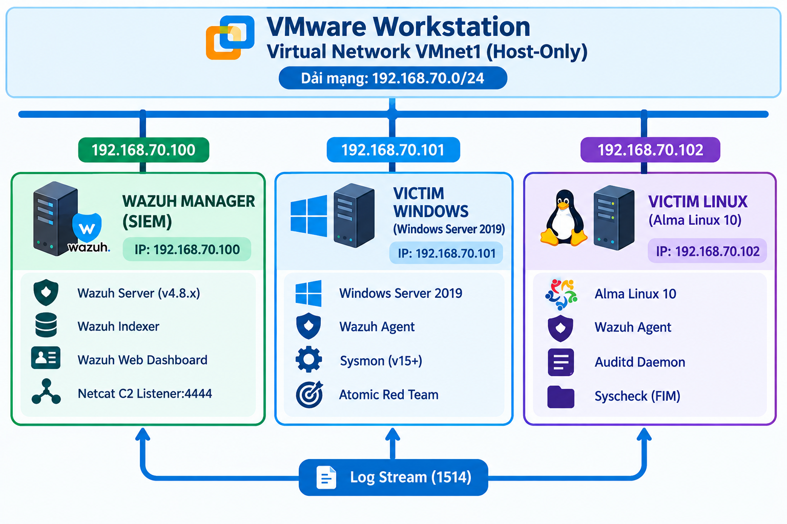
*Hình 2.1: Sơ đồ kiến trúc phân vùng mạng và các thực thể trong Purple Team Lab*

</div>

### Bảng phân bổ địa chỉ IP và tài nguyên phần cứng:

| Hostname | Hệ điều hành | Địa chỉ IP | Phần cứng | Vai trò & Công cụ |
| :--- | :--- | :--- | :--- | :--- |
| **`wazuh-manager`** | Ubuntu Server 26.04 LTS | `192.168.70.100` | 8GB RAM, 4 vCPU, 50GB Disk | Máy chủ SIEM All-in-One: Wazuh Manager, Indexer, Dashboard, Netcat C2 Listener (Port 4444) |
| **`victim-win`** | Windows Server 2019 | `192.168.70.101` | 4GB RAM, 2 vCPU, 40GB Disk | Nạn nhân Windows: Wazuh Agent, Microsoft Sysmon v15+ (SwiftOnSecurity), Invoke-AtomicRedTeam |
| **`victim-linux`** | AlmaLinux 10 | `192.168.70.102` | 2GB RAM, 2 vCPU, 30GB Disk | Nạn nhân Linux: Wazuh Agent, Auditd (`execve` / `shadow`), FIM realtime, Atomic Red Team |

---

## 🔄 3. Luồng dữ liệu giám sát (Telemetry Data Pipeline)

Quá trình thu thập, xử lý và phân tích dữ liệu nhật ký bảo mật tuân thủ nghiêm ngặt quy trình 5 bước:

<div align="center">

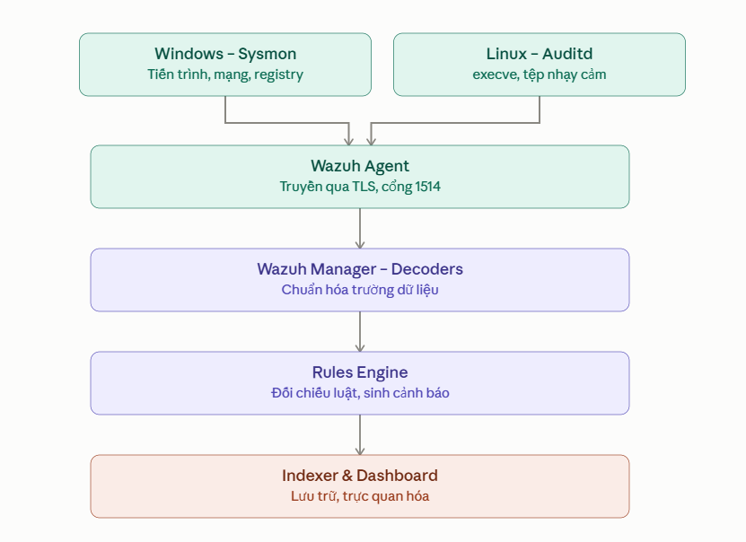
*Hình 3.1: Luồng dữ liệu Telemetry đa tầng từ thiết bị đầu cuối về máy chủ SIEM*

</div>

1. **Bước 1 - Thu thập dữ kiện mức nhân (Sensors):**
   - *Windows:* Sysmon thu thập Event ID 1 (Process Creation kèm CommandLine), Event ID 3 (Network), Event ID 10 (ProcessAccess vào LSASS), Event ID 11 (FileCreate) và Event ID 12/13 (Registry).
   - *Linux:* Auditd gắn quy tắc giám sát vào kernel, chặn bắt lời gọi `execve` (b64/b32) và tương tác tệp `/etc/shadow`, `/etc/sudoers.d`.
2. **Bước 2 - Đóng gói & Chuyển tiếp (Wazuh Agent):**
   - Agent đọc kênh `Microsoft-Windows-Sysmon/Operational` và `/var/log/audit/audit.log`, mã hóa TLS và đẩy về Manager qua cổng TCP 1514.
3. **Bước 3 - Giải mã & Chuẩn hóa (Decoders Engine):**
   - `wazuh-analysisd` phân tách dòng log thô thành các trường có cấu trúc (`win.eventdata.image`, `commandLine`, `audit.command`, `audit.key`).
4. **Bước 4 - Khớp luật & Sinh cảnh báo (Rules Matching):**
   - Đối chiếu với tập luật `custom_wazuh_rules.xml`. Nếu thỏa mãn logic bất thường (Regex PCRE2, quan hệ Cha-Con), sinh Security Alert với mức nguy cấp từ Level 10 - 14 kèm mã MITRE ATT&CK.
5. **Bước 5 - Lưu trữ chỉ mục & Trực quan hóa (Dashboard):**
   - Đánh chỉ mục tại Wazuh Indexer và hiển thị trực quan theo thời gian thực trên Wazuh Dashboard phục vụ SOC Incident Response.

---

## 📂 4. Cấu trúc thư mục dự án

```
.
├── .gitignore                          # Cấu hình loại trừ file rác, file tạm, log, dump
├── LICENSE                             # Giấy phép mã nguồn mở MIT License
├── README.md                           # Tài liệu tổng quan dự án chuẩn GitHub
│
├── configs/                            # Cấu hình cảm biến và Agent
│   ├── windows/
│   │   ├── sysmonconfig-export.xml     # Cấu hình Microsoft Sysmon v15+ tinh chỉnh
│   │   └── ossec.conf                  # Cấu hình Wazuh Agent trên Windows (Sysmon channel)
│   ├── linux/
│   │   ├── audit.rules                 # Tập luật Auditd (/etc/audit/rules.d/audit.rules)
│   │   └── ossec.conf                  # Cấu hình Wazuh Agent trên Linux (FIM realtime)
│   └── wazuh-manager/
│       └── local_rules.xml             # Tệp cấu hình nạp vào /var/ossec/etc/rules/local_rules.xml
│
├── rules/                              # Bộ luật phát hiện tùy biến (Custom Rules)
│   ├── custom_wazuh_rules.xml          # Tệp XML tổng hợp toàn bộ 9 rules + bonus rule
│   ├── windows/                        # Các quy tắc XML kiểm thử trên Windows
│   │   ├── custom_t1047.xml            # Rule 100001: Execution qua WMI (Level 12)
│   │   ├── custom_t1003_001.xml        # Rule 100002: Trích xuất bộ nhớ LSASS (Level 12)
│   │   ├── custom_t1053_005.xml        # Rule 100003: Tạo Scheduled Task ẩn danh (Level 12)
│   │   ├── custom_t1082.xml            # Rule 100004: Thu thập thông tin hệ thống (Level 12)
│   │   ├── custom_t1486.xml            # Rule 100005: Mô phỏng Akira Ransomware (Level 14)
│   │   └── custom_t1070_001.xml        # Rule 100007: Xóa Event Log hệ thống (Level 13)
│   └── linux/                          # Các quy tắc XML kiểm thử trên Linux
│       ├── custom_t1059_004.xml        # Rule 100010: Reverse Shell Base64 / Fileless (Level 12)
│       ├── custom_t1548_003.xml        # Rule 100012: Can thiệp SUDO NOPASSWD (Level 12)
│       ├── custom_t1486.xml            # Rule 100013: Ransomware shred & openssl (Level 14)
│       └── custom_t1003_008.xml        # Rule 100014: Trích xuất /etc/shadow (Level 12)
│
├── scripts/                            # Kịch bản triển khai & diễn tập tấn công
│   ├── deploy/
│   │   ├── install_wazuh_server.sh     # Cài đặt tự động Wazuh Server All-in-One trên Ubuntu
│   │   ├── setup_windows_agent.ps1     # Cài đặt Sysmon & cấu hình Wazuh Agent Windows
│   │   └── setup_linux_agent.sh        # Cài đặt Auditd & cấu hình Wazuh Agent Linux
│   ├── windows/                        # Kịch bản kiểm thử trên Windows
│   │   ├── test_t1047_wmi.ps1          # Thực thi mô phỏng T1047
│   │   ├── test_t1003_001_lsass.ps1    # Thực thi mô phỏng T1003.001
│   │   ├── test_t1053_005_schtasks.ps1 # Thực thi mô phỏng T1053.005
│   │   ├── test_t1082_discovery.ps1    # Thực thi mô phỏng T1082
│   │   ├── test_t1486_ransomware.ps1   # Thực thi mô phỏng T1486 Akira
│   │   ├── test_t1070_001_clearlog.ps1 # Thực thi mô phỏng T1070.001
│   │   ├── run_all_windows_tests.ps1   # Runner tự động chạy toàn bộ bài test Windows
│   │   └── cleanup_windows_tests.ps1   # Dọn dẹp artifact thử nghiệm trên Windows
│   └── linux/                          # Kịch bản kiểm thử trên Linux
│       ├── test_t1059_004_reverse_shell.sh # Thực thi mô phỏng T1059.004
│       ├── test_t1548_003_sudoers.sh       # Thực thi mô phỏng T1548.003
│       ├── test_t1486_ransomware.sh        # Thực thi mô phỏng T1486
│       ├── test_t1003_008_shadow.sh        # Thực thi mô phỏng T1003.008
│       ├── run_all_linux_tests.sh          # Runner tự động chạy toàn bộ bài test Linux
│       └── cleanup_linux_tests.sh          # Dọn dẹp artifact thử nghiệm trên Linux
│
└── docs/                               # Tài liệu chuyên sâu & Hình ảnh minh chứng
    ├── ARCHITECTURE.md                 # Phân tích kiến trúc mạng & Telemetry Pipeline
    ├── DETECTION_ENGINEERING.md        # Cẩm nang bóc tách log & kỹ thuật viết Custom Rule
    ├── TESTING_SCENARIOS.md            # Chi tiết 9 kịch bản kiểm thử Red/Blue Teaming
    ├── COVERAGE_MATRIX.md              # Bảng ma trận đối so sánh định lượng kết quả
    └── images/                         # Ảnh chụp sơ đồ & Bằng chứng Dashboard thực tế
```

---

## 📊 5. Ma trận độ phủ phát hiện (Detection Coverage Matrix)

| STT | Mã MITRE | Kỹ thuật kiểm thử | HĐH | Trạng thái mặc định (Baseline) | Rule ID mới | Sau tinh chỉnh (Retest) | Độ trễ |
| :---: | :---: | :--- | :---: | :--- | :---: | :--- | :---: |
| **01** | **T1047** | WMI Process Call Execution | Win | Level 3 (Tiến trình đơn lẻ) | **100001** | **Level 12** (Critical - WMI Anomaly) | `< 1.2s` |
| **02** | **T1003.001** | LSASS Dump via Procdump | Win | **Bỏ lọt** (Công cụ hợp lệ MS) | **100002** | **Level 12** (Critical - ProcessAccess) | `< 1.0s` |
| **03** | **T1053.005** | Scheduled Task Persistence | Win | Level 3 (Tạo task thông thường) | **100003** | **Level 12** (Critical - Anti-Bypass Task) | `< 1.0s` |
| **04** | **T1082** | System Information Discovery | Win | Level 3 (Lệnh đơn lẻ bị trôi) | **100004** | **Level 12** (Critical - Parent-Child Anomaly) | `< 1.1s` |
| **05** | **T1486** | Akira Ransomware Simulation | Win | **Bỏ lọt** (FIM định kỳ bị trễ) | **100005** | **Level 14** (Emergency - Script Block) | `< 0.9s` |
| **06** | **T1070.001** | Clear Windows Event Logs | Win | Level 5 (Chỉ nhận Event 1102) | **100007** | **Level 13** (Emergency - Clear Audit Log) | `< 0.8s` |
| **07** | **T1059.004** | Base64 Fileless Reverse Shell | Linux | **Bỏ lọt** (Syslog không giải mã) | **100010** | **Level 12** (Critical - Base64 Pipe Execution) | `< 1.1s` |
| **08** | **T1548.003** | Sudoers.d NOPASSWD Abuse | Linux | **Bỏ lọt** (Sửa tệp không cảnh báo)| **100012** | **Level 12** (Critical - Sudoers Realtime) | `< 1.0s` |
| **09** | **T1486** | Linux Ransomware (shred/openssl)| Linux | **Bỏ lọt** (Không gắn nhãn phá hoại)| **100013** | **Level 14** (Emergency - Shred/Openssl) | `< 0.8s` |
| **10** | **T1003.008** | OS Credential Dumping (/etc/shadow)| Linux | **Bỏ lọt** (Lệnh tar hợp lệ bị trôi)| **100014** | **Level 12** (Critical - Shadow File Access) | `< 1.0s` |

---

## 🚀 6. Hướng dẫn triển khai từng bước

### Bước 1: Triển khai máy chủ Wazuh Manager All-in-One
1. Cài đặt Ubuntu Server 26.04 / 24.04 LTS với IP tĩnh `192.168.70.100`.
2. Thực thi script cài đặt tự động:
   ```bash
   sudo bash scripts/deploy/install_wazuh_server.sh
   ```
3. Truy cập Wazuh Dashboard tại giao diện web `https://192.168.70.100` với thông tin đăng nhập trong `wazuh-passwords.txt`.

<div align="center">

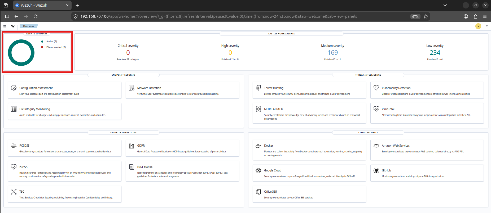
*Hình 6.1: Giao diện Overview của Wazuh Dashboard sau khi triển khai thành công*

</div>

---

### Bước 2: Cấu hình Endpoint Windows Server 2019
1. Thiết lập IP tĩnh `192.168.70.101`, Default Gateway `192.168.70.2`.
2. Mở PowerShell dưới quyền Administrator và thực thi:
   ```powershell
   Set-ExecutionPolicy Bypass -Scope Process -Force
   .\scripts\deploy\setup_windows_agent.ps1
   ```
3. Script sẽ tự động:
   - Cài đặt Microsoft Sysmon v15+ với cấu hình chuyên sâu `configs/windows/sysmonconfig-export.xml`.
   - Cấu hình Wazuh Agent thu thập kênh `Microsoft-Windows-Sysmon/Operational`.
   - Khởi động lại dịch vụ `WazuhSvc` và cài đặt `Invoke-AtomicRedTeam`.

<div align="center">

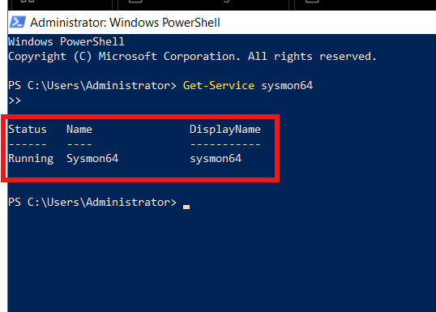  
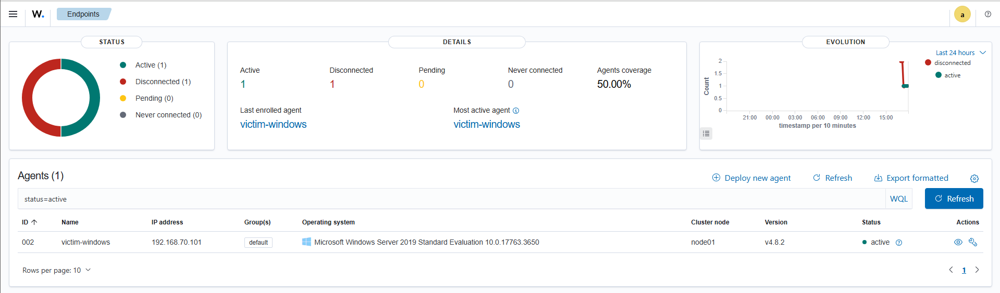  
*Hình 6.2: Dịch vụ Sysmon và Wazuh Agent kết nối thành công trên Windows*

</div>

---

### Bước 3: Cấu hình Endpoint AlmaLinux 10
1. Thiết lập IP tĩnh `192.168.70.102`.
2. Chạy script cấu hình dưới quyền root/sudo:
   ```bash
   sudo bash scripts/deploy/setup_linux_agent.sh
   ```
3. Script sẽ tự động:
   - Cài đặt `auditd audispd-plugins`.
   - Nạp các quy tắc giám sát syscall `execve` và `/etc/shadow` vào `/etc/audit/rules.d/audit.rules`.
   - Cấu hình module FIM/Syscheck thời gian thực trong `/var/ossec/etc/ossec.conf`.
   - Khởi động lại dịch vụ `auditd` và `wazuh-agent`.

<div align="center">

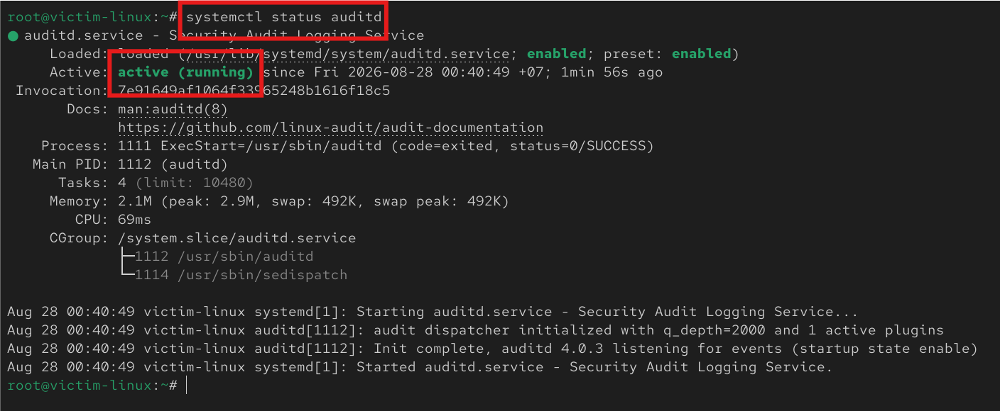  
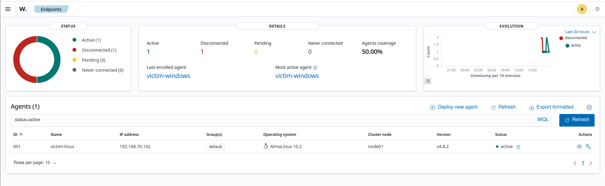  
*Hình 6.3: Dịch vụ Auditd và Wazuh Agent kết nối thành công trên Linux*

</div>

---

### Bước 4: Nạp bộ luật tùy chỉnh Custom Wazuh Rules
Trên máy chủ `wazuh-manager` (`192.168.70.100`):
1. Chèn nội dung tệp `rules/custom_wazuh_rules.xml` vào `/var/ossec/etc/rules/local_rules.xml`:
   ```bash
   sudo cat rules/custom_wazuh_rules.xml >> /var/ossec/etc/rules/local_rules.xml
   ```
2. Kiểm tra tính hợp lệ của cú pháp quy tắc:
   ```bash
   sudo /var/ossec/bin/wazuh-analysisd -t
   ```
3. Khởi động lại dịch vụ Wazuh Manager để áp dụng:
   ```bash
   sudo systemctl restart wazuh-manager
   ```

---

## 🎯 7. Kịch bản kiểm thử Purple Team & Bằng chứng phát hiện

### Thực thi kiểm thử trên Windows (`victim-win`):
Chạy từng bài kiểm tra hoặc chạy toàn bộ thông qua master runner:
```powershell
cd scripts\windows
.\run_all_windows_tests.ps1
```

#### Bằng chứng cảnh báo thực tế trên Wazuh Dashboard:

| Kỹ thuật | Hình ảnh minh chứng cảnh báo thực tế |
| :--- | :--- |
| **T1047: WMI Execution** | 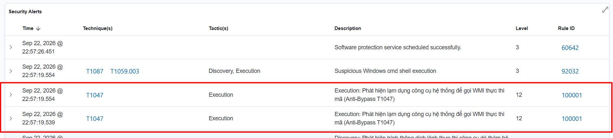 |
| **T1003.001: LSASS Dump** | 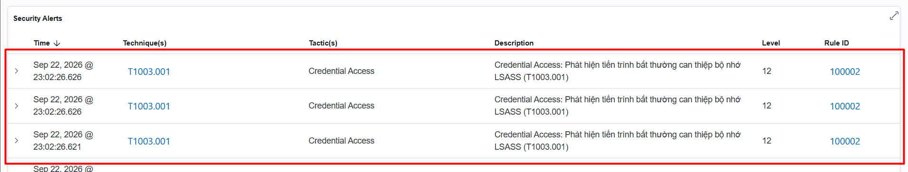 |
| **T1053.005: Scheduled Tasks** | 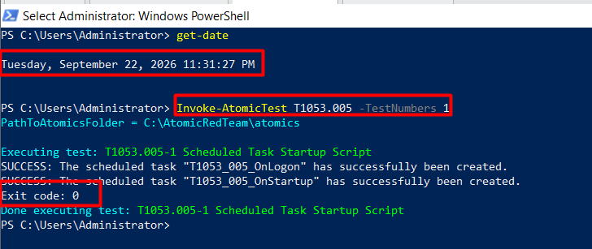 |
| **T1082: System Discovery** | 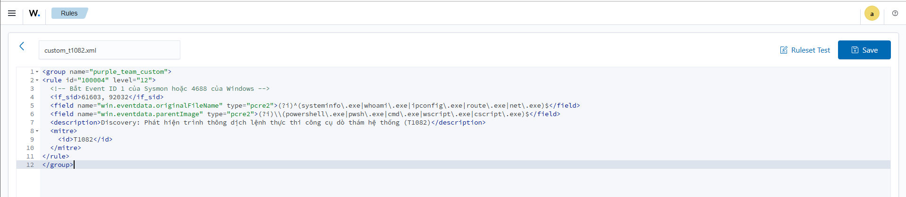 |
| **T1486: Akira Ransomware** | 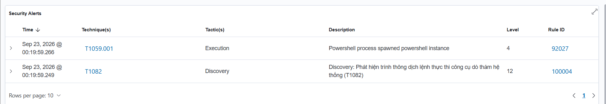 |

---

### Thực thi kiểm thử trên Linux (`victim-linux`):
Chạy từng kịch bản hoặc chạy toàn bộ thông qua master runner:
```bash
cd scripts/linux
sudo bash run_all_linux_tests.sh
```

#### Bằng chứng cảnh báo thực tế trên Wazuh Dashboard:

| Kỹ thuật | Hình ảnh minh chứng cảnh báo thực tế |
| :--- | :--- |
| **T1059.004: Reverse Shell** | 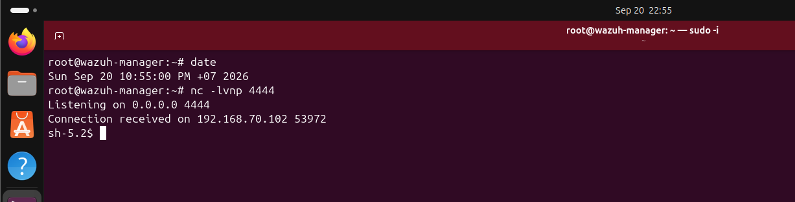 |
| **T1548.003: Sudoers Abuse** | 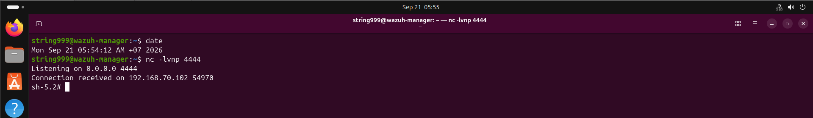 |
| **T1486: Linux Ransomware** | 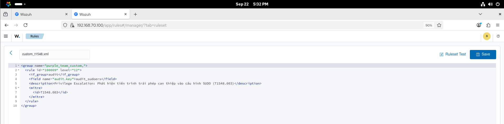 |
| **T1003.008: Shadow Access** | 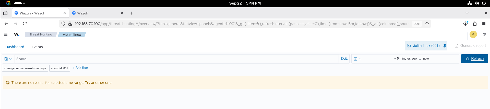 |

---

## 💡 8. Đánh giá & Hướng phát triển

### Điểm mạnh:
- **Phương pháp luận Purple Teaming khép kín:** Vòng lặp phản hồi Tấn công ➔ Phân tích log ➔ Tinh chỉnh rule ➔ Retest giúp phát hiện và lấp kín 100% điểm mù giám sát.
- **Dữ liệu Telemetry mức sâu:** Tận dụng triệt để Microsoft Sysmon và Linux Auditd để loại bỏ điểm mù về quan hệ tiến trình cha - con, lời gọi hệ thống và trích xuất bộ nhớ.
- **Tiết kiệm chi phí đầu tư:** Ứng dụng toàn bộ hệ sinh thái mã nguồn mở (Wazuh, Atomic Red Team, Sysinternals), chứng minh tính khả thi triển khai cho doanh nghiệp với chi phí bản quyền 0 đồng.

### Hạn chế còn tồn tại:
- **Áp lực dung lượng lưu trữ (Log Volume):** Nhật ký mức nhân sinh ra hàng triệu bản ghi mỗi ngày, đòi hỏi chính sách phân tầng lưu trữ (Log Rotation/Retention) phù hợp.
- **Nguy cơ lẩn tránh bằng xáo trộn mã (Obfuscation):** Cần tiếp tục gia cố các quy tắc Regex để phát hiện các kỹ thuật obfuscation phức tạp.
- **Chưa có SOAR tự động ngắt kết nối:** Hệ thống hiện dừng lại ở mức phát hiện và cảnh báo trực quan.

### Hướng phát triển mở rộng:
1. **Tích hợp Wazuh Active Response:** Tự động thực thi script ngắt kết nối mạng hoặc hủy tiến trình độc hại khi có cảnh báo khẩn cấp Level 14.
2. **Chuẩn hóa quy tắc theo chuẩn Sigma Rules:** Chuyển đổi toàn bộ quy tắc sang định dạng Sigma để có thể chia sẻ cho cộng đồng và sử dụng trên nhiều nền tảng SIEM khác.
3. **Ứng dụng Trí tuệ Nhân tạo & Machine Learning:** Tích hợp mô hình học máy (UEBA) để phát hiện bất thường hành vi người dùng và các cuộc tấn công Zero-day.

---

## 📚 9. Tài liệu tham khảo

1. Wazuh Documentation, *'Wazuh Ruleset, Decoders and Architecture Reference Guide v4.8'*, Wazuh Inc., 2024–2025. [Online]. Có sẵn tại: https://documentation.wazuh.com/
2. The MITRE Corporation, *'MITRE ATT&CK Enterprise Matrix (Version 15.1)'*, MITRE ATT&CK Knowledge Base, 2024. [Online]. Có sẵn tại: https://attack.mitre.org/
3. Red Canary Co., *'Atomic Red Team: Portable Testing Framework Mapped to MITRE ATT&CK'*, Red Canary Open Source, 2024. [Online]. Có sẵn tại: https://atomicredteam.io/
4. Mark Russinovich, *'Windows Sysinternals: System Monitor (Sysmon) v15.1 Technical Documentation'*, Microsoft Learn, 2024. [Online]. Có sẵn tại: https://learn.microsoft.com/en-us/sysinternals/downloads/sysmon
5. SwiftOnSecurity, *'Sysmon Configuration Repository for High-Quality Threat Hunting Telemetry'*, GitHub Repository, 2024. [Online]. Có sẵn tại: https://github.com/SwiftOnSecurity/sysmon-config
6. Steve Grubb et al., *'Linux Audit Subsystem (Auditd) Architecture and audit.rules Best Practices'*, Red Hat Enterprise Linux / Linux Kernel Organization, 2024.
7. Florian Roth and Thomas Patzke, *'Sigma: Generic Signature Format for SIEM and Detection Engineering Systems'*, SigmaHQ, 2024. [Online]. Có sẵn tại: https://github.com/SigmaHQ/sigma
8. SANS Institute, *'Purple Team Operations: Adversary Emulation and Detection Engineering Methodologies'*, SANS Information Security Reading Room, 2024.
9. ThS. Trương Phạm Hoài Thương, *'Tài liệu hướng dẫn và Bài giảng chuyên ngành Giám sát An ninh mạng & Vận hành SOC'*, Trường Cao đẳng An ninh mạng iSpace, 2026.
10. Microsoft Corporation, *'Windows Security Audit Events Reference (Event ID 4720, 1102, 4688, 4624)'*, Microsoft Documentation, 2024.

---

<div align="center">
  <sub>Đồ án được thực hiện bởi <b>Nguyễn Minh Trí</b> - Khóa 2024-2026 - Khoa An ninh mạng, Trường Cao đẳng An ninh mạng iSpace</sub>
</div>
